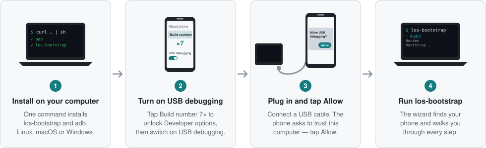

<p align="center">
  <picture>
    <source media="(prefers-color-scheme: dark)" srcset="https://raw.githubusercontent.com/richardkfm/los-bootstrap/main/docs/assets/logo-dark.svg">
    
  </picture>
</p>

<p align="center">
  <a href="https://github.com/richardkfm/los-bootstrap/actions/workflows/ci.yml"></a>
  <a href="https://pypi.org/project/los-bootstrap/"></a>
  <a href="https://github.com/richardkfm/los-bootstrap/blob/main/LICENSE"></a>
  <a href="https://lineageos.org/"></a>
  <a href="https://www.python.org/"></a>
</p>

<p align="center">
  <b>Set up a degoogled Android phone or tablet from your terminal.</b><br>
  Flash LineageOS, audit privacy, harden settings and install apps,<br>
  with the tradeoff of every recommendation spelled out.
</p>

<p align="center">
  
</p>

## Why

Getting onto a degoogled ROM used to mean piecing together a dozen forum
posts. `los-bootstrap` covers the whole path from one CLI:

- **Full lifecycle:** bootloader unlock → ROM flash → privacy audit →
  hardening → apps → location → camera.
- **It does the flashing.** It runs the real fastboot sequence:
  manufacturer-aware unlock guides (Pixel, OnePlus, Fairphone, Motorola,
  Samsung, Xiaomi), SHA-256-verified downloads, device-match checks, and a
  two-step confirm before anything destructive.
- **Honest about tradeoffs.** Every recommendation names its downside.
- **Safe by default.** Commands are read-only unless you pass `--confirm`;
  root is opt-in with `--root`.

## Get started

<p align="center">
  <picture>
    <source media="(prefers-color-scheme: dark)" srcset="https://raw.githubusercontent.com/richardkfm/los-bootstrap/main/docs/assets/getting-started-dark.svg">
    
  </picture>
</p>

**1. Install** (also installs `adb`; prints every command before running it):

```bash
curl -fsSL https://raw.githubusercontent.com/richardkfm/los-bootstrap/main/scripts/install.sh | sh
```

On Windows (PowerShell):

```powershell
irm https://raw.githubusercontent.com/richardkfm/los-bootstrap/main/scripts/install.ps1 | iex
```

Already have Python and `adb`? Run `pipx install "los-bootstrap[wizard]"`.
For the checksum-verified variant, source installs and upgrades, see
[docs/INSTALL.md](https://github.com/richardkfm/los-bootstrap/blob/main/docs/INSTALL.md).

**2. Turn on USB debugging.** On the phone, open *Settings › About phone*
(or *About tablet*) and tap *Build number* seven times. Then go to
*Settings › System › Developer options* and switch on *USB debugging*.

**3. Plug in and tap Allow.** Connect the phone with a USB cable. When it
asks *Allow USB debugging?*, tap *Allow*. Tick *Always allow from this
computer* if it is your own machine.

**4. Run it:**

```bash
los-bootstrap
```

The wizard detects your device and lets you choose what to do. Is the phone
still on its stock ROM? Choose **Flash** for the bootloader unlock and
install guide, or start with `los-bootstrap flash backup`.

## What it can do

| Command | What it does |
|---|---|
| `los-bootstrap` | Interactive guided wizard |
| `audit` / `report` | Privacy and degoogle audit (GMS, Google apps, Private DNS, ADB over network) |
| `harden` | Lockdown checks with *why* and *tradeoff*; `--interactive --confirm` applies fixes |
| `plan` / `apply --profile <name>` | Install a bundle of FOSS apps and settings from a YAML profile |
| `flash status / prepare / download / verify / run` | Unlock the bootloader and flash a ROM |
| `flash backup / check / update` | Pre-flash backup guide, first-boot check, "is my ROM current?" |
| `location doctor / compat` | Diagnose the location stack (microG, UnifiedNlp) and app compatibility |
| `integrity doctor / compat / guide` | Why banking and government apps refuse a custom ROM, and the options you have |
| `camera list-profiles / show` | GCam port recommendations per device |

The full command reference and exit codes are in
[docs/USAGE.md](https://github.com/richardkfm/los-bootstrap/blob/main/docs/USAGE.md),
and what each check does is in
[docs/FEATURES.md](https://github.com/richardkfm/los-bootstrap/blob/main/docs/FEATURES.md).

## What it does not do

It does not bypass bootloader locks or signature checks. It never ships or
fetches proprietary binaries (GCam APKs) or attestation keyboxes. It never
roots your device for you. See
[the full list](https://github.com/richardkfm/los-bootstrap/blob/main/docs/FEATURES.md#what-it-does-not-do).

## Project

- [Roadmap](https://github.com/richardkfm/los-bootstrap/blob/main/roadmap.md) ·
  [Changelog](https://github.com/richardkfm/los-bootstrap/blob/main/CHANGELOG.md) ·
  [Contributing / architecture](https://github.com/richardkfm/los-bootstrap/blob/main/CLAUDE.md) ·
  [Releasing](https://github.com/richardkfm/los-bootstrap/blob/main/docs/RELEASING.md)
- README graphics are generated by `python docs/assets/build.py`.
- License: GPL-3.0, see [LICENSE](https://github.com/richardkfm/los-bootstrap/blob/main/LICENSE).
